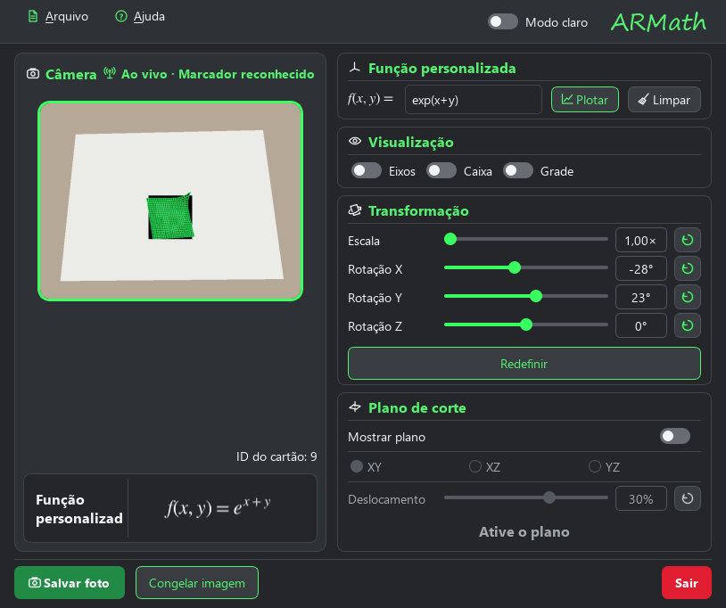
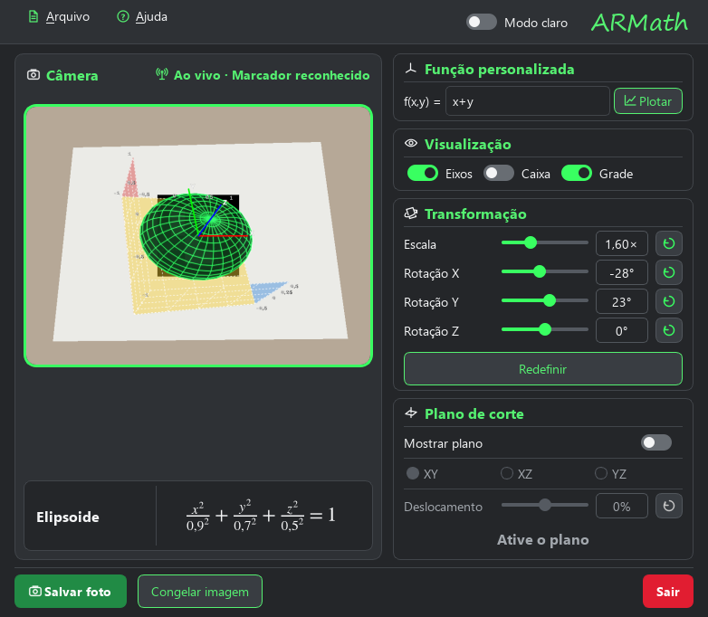
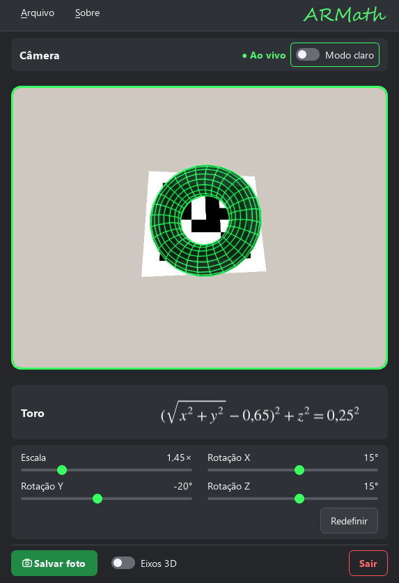
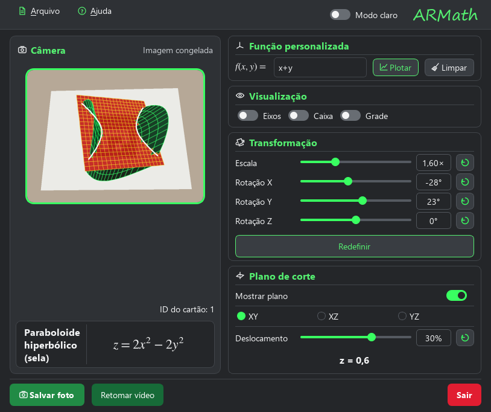
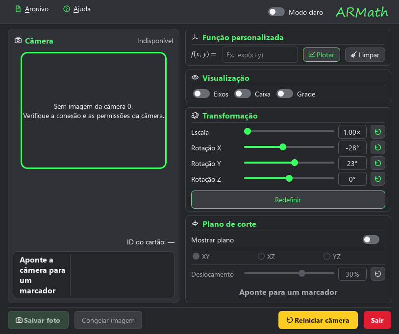
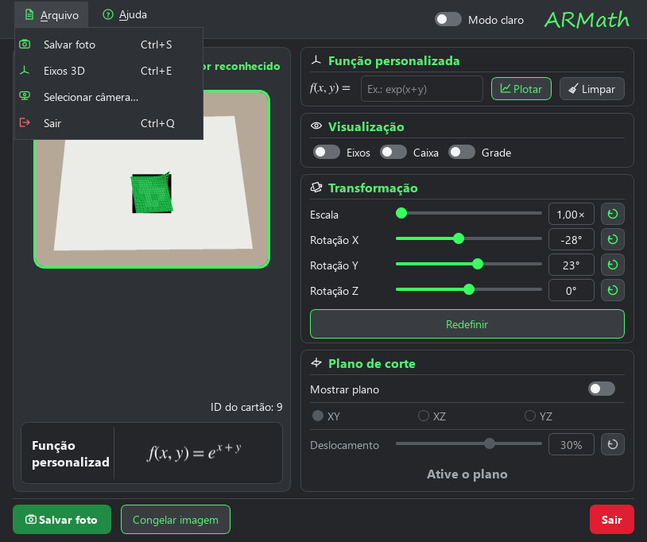
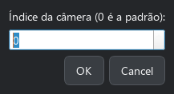
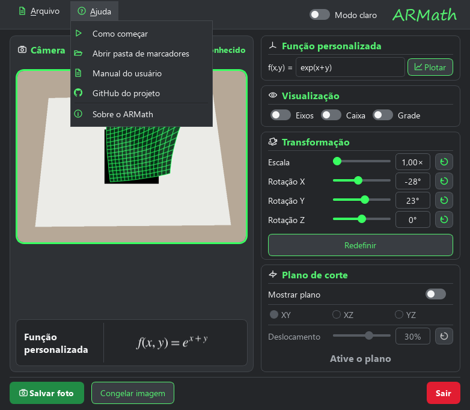

# ARMath 2.0

O **ARMath** é um aplicativo de realidade aumentada para o ensino de **Cálculo III**, criado pelo Prof. Izaias Neri. A webcam reconhece um marcador ArUco e projeta uma superfície matemática sobre o vídeo. O nome e a equação da superfície aparecem abaixo da prévia.

## Como começar

Na pasta `ARMAth_2.0`, instale as dependências e abra o aplicativo:

```powershell
python -m pip install -r requirements.txt
python armath.py
```

Mostre um [marcador ArUco](marcadores) inteiro à webcam, com a margem branca visível. Você pode imprimir o PNG ou exibi-lo em outro dispositivo. Os marcadores **0 a 8** da versão 1.0 continuam funcionando. O [marcador 9](marcadores/marcador_9.png) é reservado para a função personalizada.

Para gerar os arquivos PNG novamente, execute `python armath.py --gerar-marcadores marcadores`.

## Telas e funcionalidades

As imagens abaixo são capturas da interface do aplicativo com quadros simulados da câmera.

### Função personalizada

No painel **Função personalizada**, escreva a expressão depois de **f(x,y) =** e clique em **Plotar** ou pressione **Enter**. Aponte a câmera para o marcador 9 para ver a superfície e a fórmula renderizada abaixo da imagem. A função inicial é `x+y`. Cada expressão válida substitui a anterior durante a sessão. Se houver um erro, a última função válida permanece.

Exemplos: `exp(x+y)`, `x^2-y^2` e `sqrt(x^2+y^2)`. Use `*` para multiplicar. O marcador 9 usa o domínio ([-5,5] × [-5,5]). A malha é reduzida para a visualização, e a grade e os cortes indicam as coordenadas matemáticas.



### Visualização e transformação

| Controle | Como funciona |
| --- | --- |
| **Eixos** | Mostra os eixos coloridos com as letras X, Y e Z em branco. |
| **Caixa** | Desenha as arestas brancas da caixa que delimita a superfície. |
| **Grade** | Mostra três planos de referência translúcidos: XY amarelo, XZ azul e YZ vermelho. As linhas são brancas e tracejadas, e os números indicam coordenadas da superfície. |
| **Escala** | Ajusta a ampliação de **1× a 3×**. |
| **Rotação X, Y e Z** | Gira a superfície ao redor do marcador, de **−180° a 180°** em cada eixo. Os elementos de visualização acompanham a rotação. |
| **Redefinir** | Restaura a escala para **1×** e as rotações para **0°**. As setas circulares dos seletores redefinem cada valor individualmente. |

**Grade e eixos ativados**



**Caixa ativada**


### Plano de corte

Ative **Mostrar plano** e selecione **XY**, **XZ** ou **YZ**. As opções e o controle de **Deslocamento** ficam visíveis mesmo quando o plano está desligado. Quando ativo, o painel exibe a coordenada do corte no eixo perpendicular ao plano. A curva de interseção aparece em branco quando há corte.



### Congelar imagem e salvar foto

**Congelar imagem** conserva o quadro atual para que você possa girar a superfície, ajustar a escala e explorar os cortes sem segurar o marcador na frente da webcam. Clique em **Retomar vídeo** para voltar à transmissão. **Salvar foto** exporta em PNG o quadro exibido com a sobreposição.



### Estado da câmera e recuperação

| Estado | O que aparece |
| --- | --- |
| **Conectando** | A câmera está em inicialização. [Ver captura](docs/imagens/armath-2-conectando.png). |
| **Ao vivo · Aguardando marcador** | A transmissão está ativa. Mostre um marcador com os quatro cantos visíveis. [Ver captura](docs/imagens/armath-2-aguardando-marcador.png). |
| **Ao vivo · Marcador reconhecido** | A superfície e a equação estão disponíveis para exploração. |
| **Imagem congelada** | O quadro exibido fica fixo, com os ajustes de visualização disponíveis. |
| **Indisponível** | Verifique a webcam e as permissões do Windows. Use o botão amarelo **Reiniciar câmera** para tentar novamente. |



### Temas claro e escuro

O seletor ao lado da marca ARMath indica o tema que será ativado. O aplicativo abre no tema escuro. Ao mudar para o tema claro, o seletor passa a mostrar **Modo escuro**.


## Menus

### Arquivo



| Item | O que faz |
| --- | --- |
| **Salvar foto** (`Ctrl+S`) | Salva o quadro exibido em PNG. |
| **Eixos 3D** (`Ctrl+E`) | Alterna o controle **Eixos** do painel **Visualização**. |
| **Reiniciar câmera** | Tenta reconectar a webcam. A opção aparece quando a câmera está indisponível. |
| **Selecionar câmera** | Permite escolher outra webcam pelo índice. **0** é o índice padrão. |
| **Sair** (`Ctrl+Q`) | Fecha o aplicativo. |



### Ajuda



| Item | O que faz |
| --- | --- |
| **Como começar** | Mostra três passos para usar a webcam e reconhecer o primeiro marcador. |
| **Abrir pasta de marcadores** | Abre a pasta com os PNGs originais. |
| **Manual do usuário** | Abre o [manual em PDF](docs/Manual_ARMath.pdf), com instruções e marcadores para impressão. |
| **GitHub do projeto** | Abre a [página do ARMath 2.0 no GitHub](https://github.com/izaiasneri/ARmath/tree/main/ARMAth_2.0). |
| **Sobre o ARMath** | Exibe a versão e os créditos do aplicativo. |


