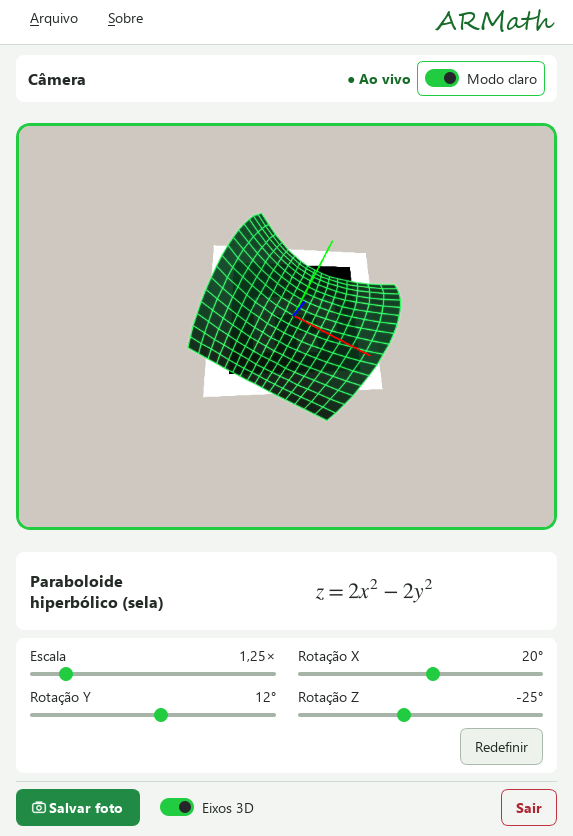
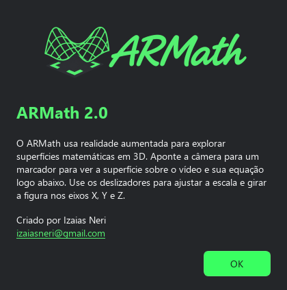

# ARMath 2.0

O ARMath 2.0 usa marcadores ArUco para projetar superfícies matemáticas sobre o vídeo da câmera. Os nove marcadores da versão 1.0 também funcionam nesta edição.

## O que mudou na versão 2.0

A interface ganhou controles de escala e rotação para manipular a superfície sem mover o marcador. Os eixos 3D acompanham a rotação, e o botão **Redefinir** restaura a posição e o tamanho iniciais. A malha e os detalhes da interface passaram para verde neon, com opção de alternar entre os temas escuro e claro.

## Telas do aplicativo

As capturas mostram a interface do ARMath 2.0 com quadros simulados da câmera.

**Modo escuro com um toro em verde neon**


**Modo claro com os eixos 3D ativados**



**Janela Sobre**



## Como executar

Na pasta `ARMAth_2.0`, instale as dependências, caso ainda não estejam instaladas, e execute o aplicativo.

```powershell
python -m pip install -r requirements.txt
python armath.py
```

Os PNGs para imprimir estão na pasta `marcadores`. Para gerar mais cópias, execute `python armath.py --gerar-marcadores marcadores`.

## Controles

- **Escala** ajusta o tamanho da superfície de **1× a 3×**, com valor inicial de **1×**.
- **Rotação X, Y e Z** gira a malha em torno do centro do marcador. Cada controle vai de **−180° a 180°**.
- **Eixos 3D** mostra os eixos X, Y e Z, que giram junto com a superfície.
- **Redefinir** volta à escala **1×** e às três rotações em **0°**.
- **Modo claro** alterna o tema da interface. O aplicativo abre no modo escuro.
- **Salvar foto** captura o quadro com a superfície no tamanho e na orientação atuais.

A malha 3D aparece em verde neon sobre o vídeo. O nome e a equação são exibidos abaixo da prévia.
