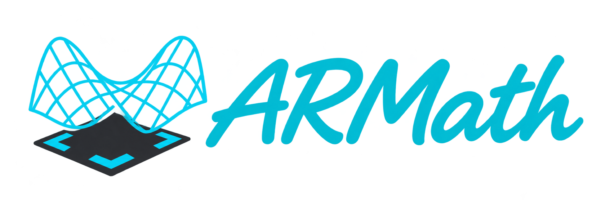
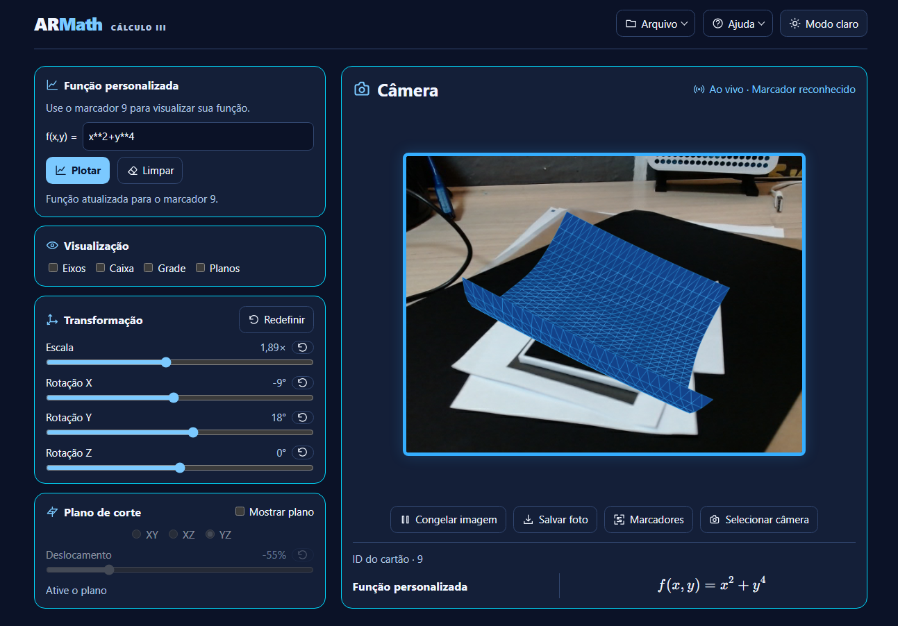
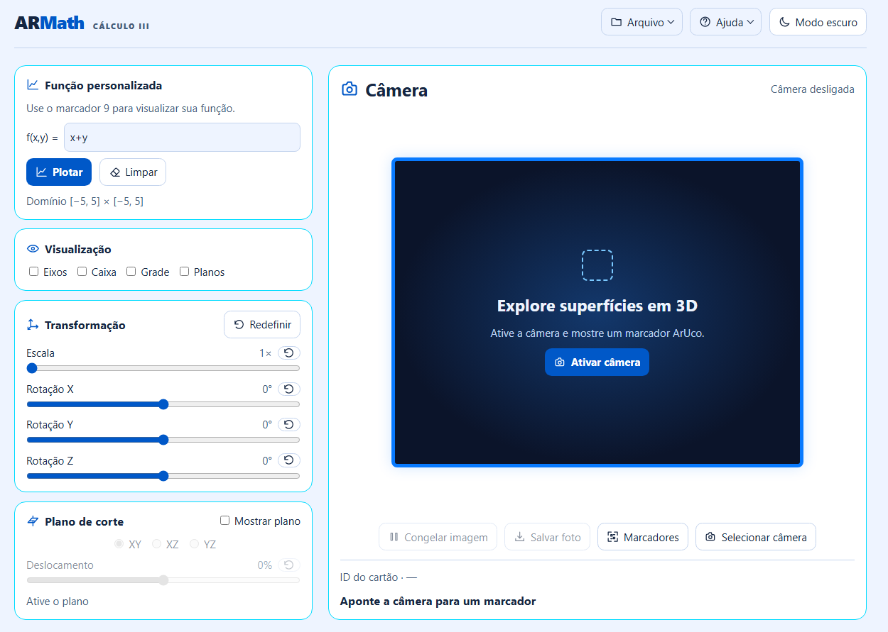
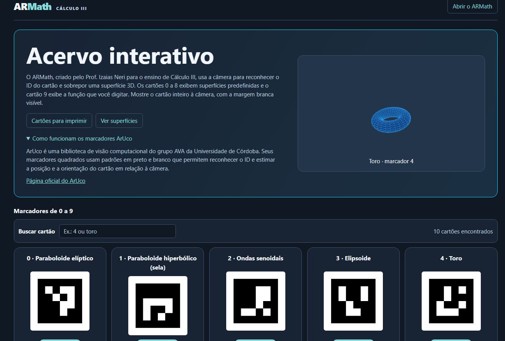

# ARMath JS

O **ARMath JS** é a versão web do aplicativo de realidade aumentada criado pelo Prof. Izaias Neri para o ensino de **Cálculo III**. Ao reconhecer um cartão ArUco, a câmera exibe a superfície 3D sobre o vídeo. O painel abaixo do quadro mostra o ID do cartão, o nome da superfície e sua equação.

## Comece a usar

1. Sirva a pasta `ARmath_Js` com um servidor estático em `localhost` ou acesse a página hospedada em HTTPS.
2. Abra `index.html` no navegador, clique em **Ativar câmera** e conceda a permissão de vídeo.
3. Mostre um cartão inteiro à câmera, com a margem branca visível.
4. Use os controles à esquerda para explorar a superfície. Abra **Marcadores** para obter os cartões e consultar exemplos.

Consulte o [manual ilustrado em PDF](static/Manual_ARMathJS.pdf) para conhecer os menus, as janelas e cada controle. O cabeçalho permite alternar entre os modos claro e escuro.

## Explore as superfícies

| Recurso | O que faz |
| --- | --- |
| **Visualização** | Mostra eixos, caixa, grade de referência ou os três planos que passam pela origem. **Grade** e **Planos** são opções alternadas. |
| **Transformação** | Ajusta a escala entre 1× e 3× e gira o gráfico em X, Y e Z. |
| **Plano de corte** | Exibe um corte XY, XZ ou YZ. O controle de deslocamento altera a posição do plano e a interseção aparece em branco quando existe. |
| **Congelar imagem** | Fixa o quadro para permitir ajustes e observação antes de retomar o vídeo. |
| **Salvar foto** | Exporta o quadro exibido em PNG com a superfície sobreposta. |
| **Selecionar câmera** | Permite escolher o dispositivo de vídeo. Para liberar a câmera, use **Arquivo → Encerrar sessão**. |

## Cartões ArUco

No [Acervo interativo](marcadores.html), busque pelo ID ou pelo nome da superfície. Cada cartão tem os botões **Imprimir** e **Baixar PNG**. A seção **Veja os exemplos** mostra a superfície associada a cada cartão.

| ID | Superfície |
| --- | --- |
| 0 | Paraboloide elíptico |
| 1 | Paraboloide hiperbólico (sela) |
| 2 | Ondas senoidais |
| 3 | Elipsoide |
| 4 | Toro |
| 5 | Hiperboloide de uma folha |
| 6 | Cone duplo |
| 7 | Superfície gaussiana |
| 8 | Ondulações concêntricas |
| 9 | Função personalizada. A expressão inicial é `x+y`. |

Os [cartões originais](static/marcadores) usam o dicionário ArUco `DICT_4X4_50`.

### Plote uma função com o cartão 9

Mostre o cartão 9 à câmera, digite apenas o lado direito de `f(x,y) =` e clique em **Plotar**. Experimente `x^2-y^2`, `x**2+y**4` ou `sqrt(x^2+y^2)`.

- Use `x`, `y`, `pi` e `e`. As operações aceitas incluem `+`, `-`, `*`, `/`, `^` e `**`.
- Use ponto decimal, multiplicação explícita e parênteses quando necessário. As funções disponíveis são `sin`, `cos`, `tan`, `exp`, `sqrt`, `log` e `abs`.
- A expressão deve ter até 120 caracteres e valores reais e finitos nos pontos amostrados da malha em [−5, 5] × [−5, 5]. Se for inválida, o aplicativo mostra um aviso com exemplos de sintaxe.

## Como funciona

A aplicação usa HTML, CSS e JavaScript. O [detector ArUco](static/vision.js) lê os cartões e estabiliza o rastreamento dos cantos. O [renderizador](static/surfaces.js) calcula as malhas, projeta os pontos e desenha as superfícies com Canvas 2D. Os quadros da câmera são processados no próprio navegador.

O [KaTeX](static/vendor/katex) formata as equações com saída HTML e MathML. A biblioteca e as fontes acompanham o projeto para uso offline. A aplicação roda sem Node.js ou Python.
