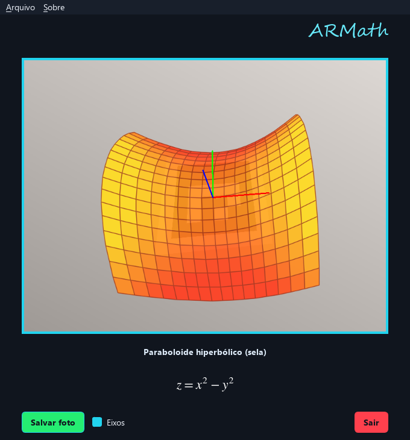
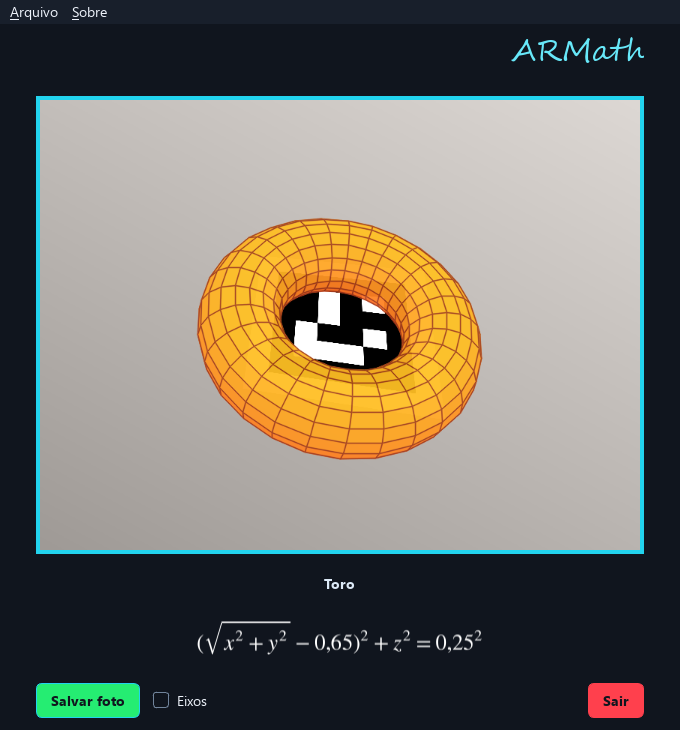
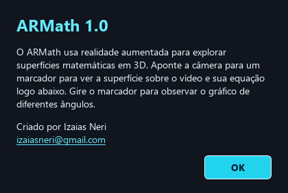

# ARMath 1.0

ARMath é um aplicativo de realidade aumentada para explorar superfícies matemáticas em 3D. Feito em Python com PySide6, OpenCV, NumPy e Matplotlib, ele identifica marcadores ArUco na câmera e projeta a superfície correspondente sobre o vídeo. Ao inclinar ou girar o marcador, você observa o gráfico de outro ângulo. O nome e a equação aparecem abaixo da prévia.

## Telas do aplicativo

As capturas mostram a interface do ARMath com quadros simulados para ilustrar o reconhecimento dos marcadores.

**Paraboloide hiperbólico com os eixos ativados**



**Toro com sua equação**



**Janela Sobre**



## Executar no Windows

Você precisa de Python e de uma câmera para acompanhar as superfícies ao vivo. Na pasta do projeto, execute:

```powershell
python -m venv .venv
.\.venv\Scripts\python.exe -m pip install -r requirements.txt
.\.venv\Scripts\python.exe armath.py --gerar-marcadores marcadores
.\.venv\Scripts\python.exe armath.py
```

Imprima os PNGs da pasta [marcadores](marcadores) ou mostre-os na tela de outro dispositivo. Mantenha a margem branca do marcador visível e aponte a câmera para ele. Para usar outra câmera, passe `--camera 1` ao iniciar.

## Marcadores disponíveis

| Arquivo | Superfície | Equação |
| --- | --- | --- |
| `marcador_0.png` | Paraboloide elíptico | $z=x^2+y^2$ |
| `marcador_1.png` | Paraboloide hiperbólico (sela) | $z=x^2-y^2$ |
| `marcador_2.png` | Ondas senoidais | $z=\sin(x)\cos(y)$ |
| `marcador_3.png` | Elipsoide | $\frac{x^2}{0{,}9^2}+\frac{y^2}{0{,}7^2}+\frac{z^2}{0{,}5^2}=1$ |
| `marcador_4.png` | Toro | $(\sqrt{x^2+y^2}-0{,}65)^2+z^2=0{,}25^2$ |
| `marcador_5.png` | Hiperboloide de uma folha | $x^2+y^2-z^2=0{,}45^2$ |
| `marcador_6.png` | Cone duplo | $x^2+y^2=z^2$ |
| `marcador_7.png` | Superfície gaussiana | $z=e^{-3(x^2+y^2)}$ |
| `marcador_8.png` | Ondulações concêntricas | $z=\cos(6\sqrt{x^2+y^2})$ |

O painel abaixo da câmera mostra o nome e a fórmula da superfície. Quando há mais de um marcador reconhecido, a janela acompanha o maior que puder ser projetado. A projeção usa parâmetros aproximados da câmera.

- **Ctrl+S** salva em PNG o quadro exibido, incluindo a superfície e os eixos quando visíveis.
- **Ctrl+E** alterna os eixos, com X em vermelho, Y em verde e Z em azul.
- **Ctrl+Q** fecha a janela e libera a câmera.

Se a câmera ficar indisponível, use **Reiniciar câmera** para tentar a conexão novamente sem fechar o ARMath.

Para ajustar o tamanho das superfícies projetadas, altere `SURFACE_SCALE` em `armath.py`. O valor padrão é `1.30`, e `1.0` corresponde ao tamanho original. Reabra o aplicativo para aplicar a alteração.

Para adicionar uma superfície, inclua um ID de 0 a 49 ainda livre no dicionário `SURFACES` em `armath.py`. Informe o nome, a fórmula em sintaxe LaTeX e uma função sem argumentos que construa a malha. Use `partial(surface_mesh, função)` para um gráfico de duas variáveis ou `partial(angular_mesh, parametrização, início, fim)` para malhas de revolução e outras malhas com um parâmetro angular. Em seguida, execute novamente a geração dos marcadores.

## Créditos

Criado por **Izaias Neri**. [Contato por e-mail](mailto:izaiasneri@gmail.com).
