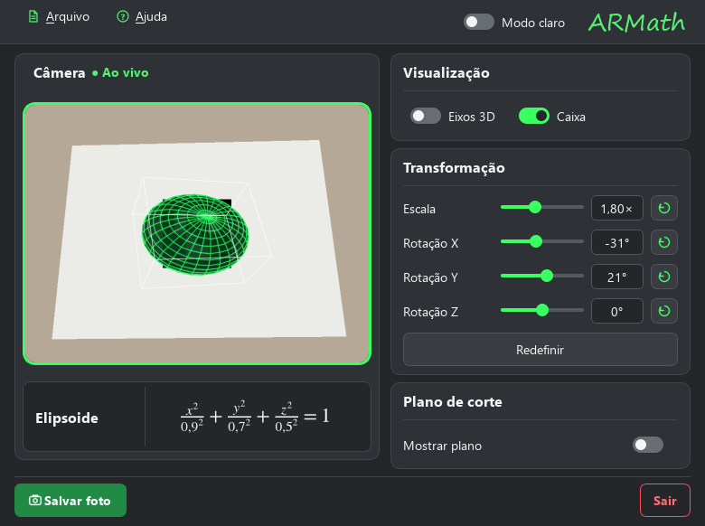

# ARMath

O **ARMath** é um aplicativo de realidade aumentada criado pelo Prof. Izaias Neri para o ensino de **Cálculo III**. Aponte uma webcam para um marcador ArUco para ver uma superfície tridimensional sobreposta ao vídeo, com seu nome e sua equação abaixo da imagem.

Na **versão 2.0**, os alunos podem girar e ampliar superfícies, exibir os eixos e a caixa que delimita a figura e explorar interseções com planos de corte. Entre os exemplos estão o elipsoide, o toro e o paraboloide hiperbólico.

[Como executar o ARMath 2.0, imprimir os marcadores e usar os controles](ARMAth_2.0/README.md)

## Documentação

- [Visão geral e instalação](docs/01_Visao_Geral_e_Instalacao.pdf)
- [Manual do usuário](docs/02_Manual_do_Usuario.pdf)
- [Arquitetura e decisões técnicas](docs/03_Arquitetura_e_Decisoes_Tecnicas.pdf)
- [Changelog](docs/04_Changelog.pdf)
